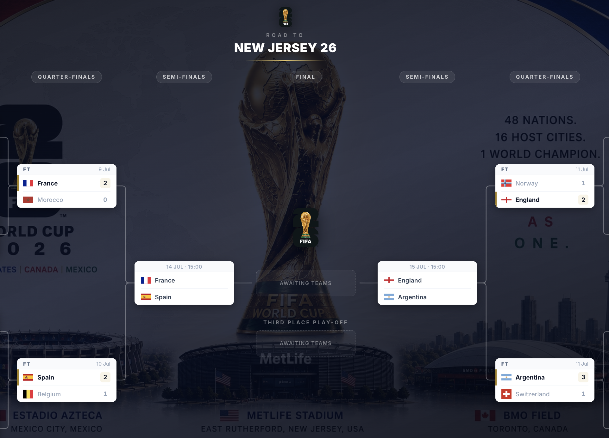
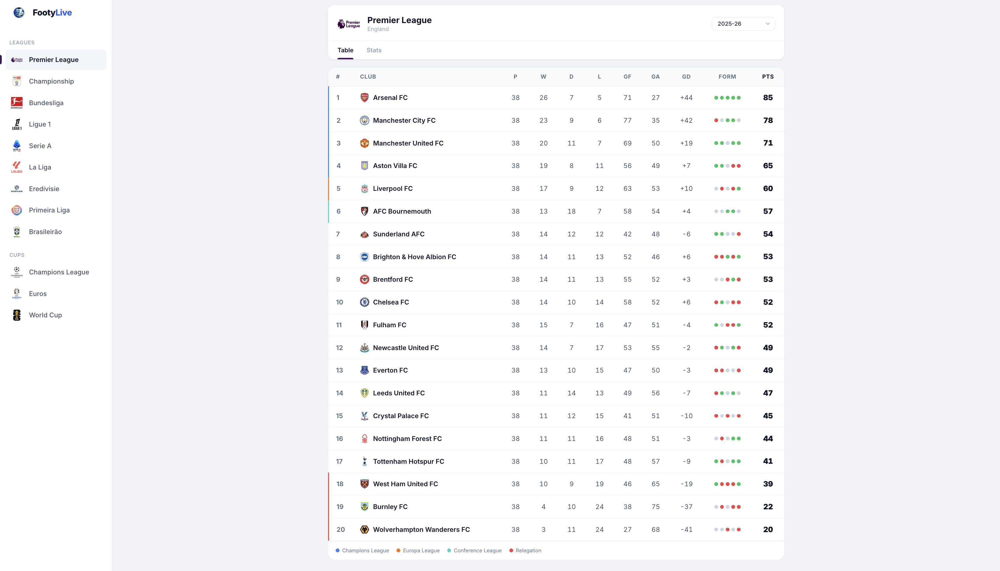
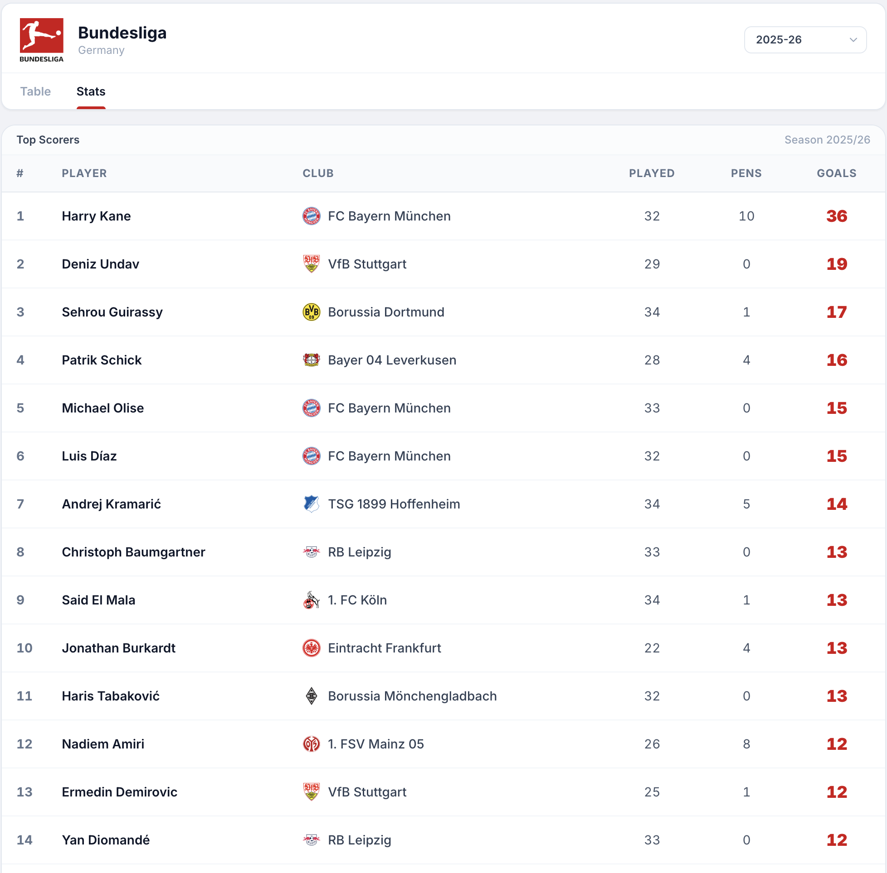
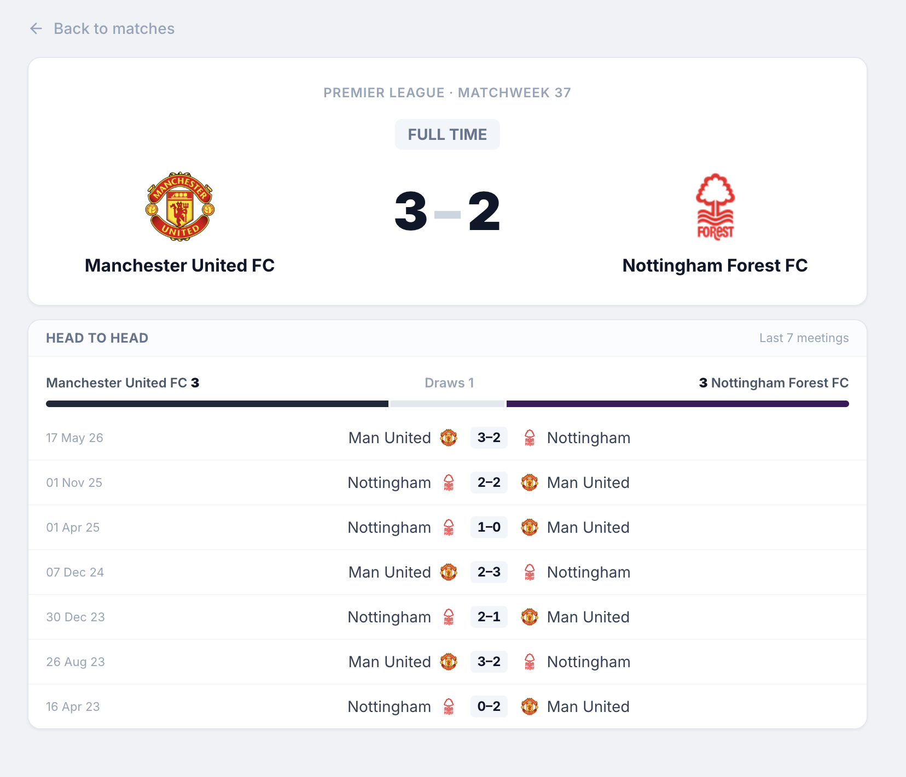

# FootyLive

Live football scores, fixtures, standings, knockout brackets, and season archives across major leagues and tournaments — powered by [football-data.org](https://www.football-data.org).

**Repo:** [github.com/LightAnd2/FootyLive](https://github.com/LightAnd2/FootyLive)

---

## Features

### Knockout brackets

UCL, Euro, and World Cup rendered as a broadcast-style "Road to the Final" — per-cup theming and trophy, two-leg aggregation, penalty-shootout scoring, live-tie indicators, a leg-by-leg breakdown on click, and a champions banner once the final is decided.


*FIFA World Cup 2026 — Road to New Jersey 26 (quarter-finals onward; earlier rounds scroll into view)*

### Season archives

Finished seasons are snapshotted into the local database and served from a season dropdown: final table + top scorers for leagues, bracket + top scorers for cups. Archived seasons never touch the external API again.


*Premier League 2025-26 — final table served straight from the archive, with qualification zones and form*

### Top scorers

Goals leaderboard per competition — games played, penalties, and goals — with an automatic fallback to last season's data in the off-season.


*Bundesliga 2025-26 golden boot race*

### Head-to-head

Every match page shows the recent meeting history between the two sides with a win/draw/loss split.


*Man United vs Nottingham Forest — result, then their last seven meetings at a glance*

### And more

- **Live scores** — real-time updates over WebSockets with automatic polling fallback
- **Match tabs** — Live, Today, Upcoming, Results, plus Table, Stats, and Teams per competition
- **12 competitions** — sidebar navigation with league-themed accents
- **Standings** — league tables with qualification zones, form, and goal difference
- **Club profiles** — squad, coach, venue, recent results, and upcoming fixtures (domestic leagues)
- **Player profiles** — click a squad member for position, age, nationality, and contract details
- **Favourites** — star teams in the Teams tab for quick access
- **Auto-recovery** — background sync catches finished games even if the server was offline during play
- **Responsive UI** — sidebar collapses to icons on mobile

### Competitions

| Leagues | Cups |
|---|---|
| Premier League | Champions League |
| Championship | Euros |
| Bundesliga | FIFA World Cup |
| Ligue 1 | |
| Serie A | |
| La Liga | |
| Eredivisie | |
| Primeira Liga | |
| Brasileirão | |

---

## Tech Stack

| Layer | Technology |
|---|---|
| Frontend | React 18, TypeScript, Vite, Tailwind CSS |
| Routing | React Router v6 |
| Real-time | WebSockets (FastAPI) |
| Backend | Python 3.11+, FastAPI, Uvicorn |
| Database | SQLite + SQLAlchemy |
| External API | [football-data.org](https://www.football-data.org) (free tier) |
| Caching | In-memory cache (optional Redis) |

---

## Quick Start

### Prerequisites

- Python 3.11+
- Node.js 18+
- A free API key from [football-data.org](https://www.football-data.org/client/register)

### 1. Clone the repo

```bash
git clone https://github.com/LightAnd2/FootyLive.git
cd FootyLive
```

### 2. One-shot setup (optional)

```bash
chmod +x setup.sh
./setup.sh
```

### 3. Backend

```bash
cd backend
python3 -m venv venv
source venv/bin/activate          # Windows: venv\Scripts\activate
pip install -r requirements.txt

cp .env.example .env
# Add your FOOTBALL_DATA_API_KEY to .env

uvicorn main:app --reload --host 127.0.0.1 --port 8000
```

Seed match data after the first run:

```bash
curl -X POST http://localhost:8000/api/matches/sync
```

### Archiving a finished season

When a season or tournament ends, freeze it into the local database so the season dropdown can serve it forever without hitting the external API:

```bash
cd backend

# Aug-May leagues and cups — label with the cross-year span
python scripts/archive_season.py PL 2025-26
python scripts/archive_season.py CL 2025-26

# Single-year tournaments — label with the year
python scripts/archive_season.py EC 2024

# Calendar-year leagues (e.g. Brasileirão) — pin the exact API season
python scripts/archive_season.py BSA 2025 --season-year 2025
```

Leagues store the final table + top scorers; cups store the knockout bracket + top scorers. Re-running the command updates the existing archive in place.

### 4. Frontend

```bash
cd frontend
npm install
cp .env.example .env
npm run dev
```

Open [http://localhost:5173](http://localhost:5173).

API docs: [http://localhost:8000/api/docs](http://localhost:8000/api/docs)

---

## Environment Variables

### Backend (`backend/.env`)

| Variable | Description |
|---|---|
| `FOOTBALL_DATA_API_KEY` | Your football-data.org API key (required) |
| `ENVIRONMENT` | `development` or `production` |
| `API_PLAN` | `default` or `premium` |
| `DATABASE_URL` | Defaults to `sqlite:///./footylive.db` |
| `BACKEND_CORS_ORIGINS` | Comma-separated frontend origins |
| `ALLOWED_HOSTS` | Comma-separated hosts the API will serve |
| `DOCS_ENABLED` | Set `false` to hide `/api/docs` in production |

### Frontend (`frontend/.env`)

| Variable | Description |
|---|---|
| `VITE_API_ORIGIN` | Backend URL, e.g. `http://127.0.0.1:8000` |
| `VITE_WS_URL` | WebSocket URL, e.g. `ws://127.0.0.1:8000/ws` |

See [API_SETUP.md](API_SETUP.md) for more detail.

---

## Docker

```bash
# From the repo root — set FOOTBALL_DATA_API_KEY in your shell or a root .env
docker-compose up --build
```

Backend: `http://localhost:8000` · Frontend: `http://localhost:3000`

---

## Deployment

### Backend (Railway, Render, Fly.io, etc.)

1. Point the service at the `backend/` directory
2. Set env vars from `backend/.env.example`
3. Use a persistent volume or hosted DB if you move off SQLite
4. Run `POST /api/matches/sync` once after deploy

### Frontend (Vercel, Netlify, etc.)

1. Set root directory to `frontend/`
2. Build command: `npm run build`
3. Output directory: `dist`
4. Set `VITE_API_ORIGIN` and `VITE_WS_URL` to your hosted backend

---

## API Reference

| Method | Endpoint | Description |
|---|---|---|
| `GET` | `/api/matches/live` | Live matches (`?competition=PL`) |
| `GET` | `/api/matches/today` | Today's matches |
| `GET` | `/api/matches/upcoming` | Upcoming fixtures |
| `GET` | `/api/matches/{id}` | Match detail with events |
| `GET` | `/api/matches/{id}/h2h` | Head-to-head record between the two teams |
| `POST` | `/api/matches/sync` | Sync matches from football-data.org |
| `GET` | `/api/standings` | League table (`?season=2025-26` for an archived season) |
| `GET` | `/api/standings/bracket` | Knockout bracket (`?competition=CL`, `?season=` for archives) |
| `GET` | `/api/scorers` | Top scorers (`?season=` for archives) |
| `GET` | `/api/seasons` | Archived seasons available for a competition |
| `GET` | `/api/teams` | Teams in a competition |
| `GET` | `/api/teams/{id}/history` | Results and upcoming fixtures |
| `GET` | `/api/teams/{id}/details` | Squad, coach, venue |
| `GET` | `/api/players/{id}/profile` | Player profile (position, age, contract) |
| `WS` | `/ws` | Live score push |

---

## Project Structure

```
FootyLive/
├── backend/            # FastAPI app, models, services
│   └── scripts/        # archive_season.py — freeze finished seasons
├── frontend/           # React + Vite UI
├── docs/               # Screenshots
├── API_SETUP.md        # API key setup guide
├── RATE_LIMITING.md    # Rate limit notes
└── docker-compose.yml
```

---

## License

MIT
